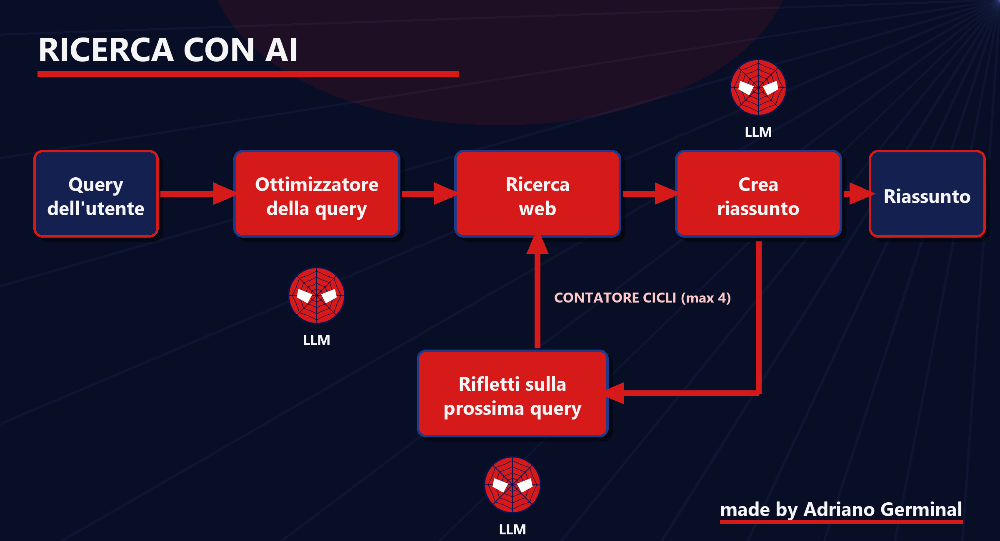

# Info Segugio

Un assistente per la ricerca sul web costruito con [Chainlit](https://docs.chainlit.io), OpenAI e [Tavily](https://tavily.com), con un tema a tinte Spider-Man. L'assistente si chiama **spider_segugio**.

Gli scrivo un argomento e lui prepara una query di ricerca, cerca le fonti sul web, ne ricava un riassunto e continua ad approfondire per qualche ciclo, aggiornando il riassunto ogni volta.



## Come funziona

1. **Ottimizzatore della query**: un LLM trasforma la richiesta dell'utente in una query di ricerca più efficace e spiega su quale aspetto si concentra.
2. **Ricerca web**: Tavily restituisce le fonti più rilevanti (fino a 5 risultati).
3. **Riassunto**: un LLM sintetizza i risultati. Dal secondo ciclo in poi estende il riassunto già esistente invece di ricominciare.
4. **Riflessione**: un LLM individua cosa manca nel riassunto e formula la domanda per la ricerca successiva.
5. Si torna al punto 2 finché il contatore dei cicli non arriva a zero (4 cicli in totale).

A ogni passaggio la chat mostra un messaggio di `system_assistant`, così si vede cosa sta facendo l'applicativo.

## Requisiti

- Python 3.11 o superiore
- [Poetry](https://python-poetry.org/)
- Una chiave API di OpenAI
- Una chiave API di Tavily

## Installazione

```bash
poetry install
```

Poi crea un file `.env` nella root del progetto con le chiavi:

```
OPENAI_API_KEY=la-tua-chiave-openai
tvly-YOUR_API_KEY=la-tua-chiave-tavily
```

Il nome della seconda variabile è quello che legge il codice in `web_research`: se lo cambi nel `.env`, cambialo anche lì.

## Avvio

```bash
poetry run chainlit run info_segugio/__init__.py -w
```

L'opzione `-w` ricarica l'app in automatico quando salvo una modifica. L'app si apre su http://localhost:8000.

## Struttura

```
info_segugio/
  __init__.py   logica della chat e funzioni di ricerca
  config.py     modello, URL e chiave API
  prompts.py    prompt per query, riassunto e riflessione
public/
  theme.json    colori e font del tema
  custom.css    ritocchi grafici
  logo_*.png    logo per tema chiaro e scuro
  favicon.png
  flusso.png    schema del flusso di ricerca
.chainlit/
  config.toml   impostazioni di Chainlit (nome, CSS personalizzato)
chainlit.md     schermata di benvenuto dell'app
```

## Configurazione

Modello e endpoint si cambiano in `info_segugio/config.py`. Nello stesso file c'è già la configurazione commentata per usare Ollama in locale al posto di OpenAI.

Il numero di cicli è la variabile `max_cycles` in `main`, mentre il numero di risultati per ricerca è `max_results` in `web_research`.

## Tema

La grafica sta tutta in `public/`. I colori si cambiano in `theme.json`, il resto in `custom.css`.

---

Made by Adriano Germinal
